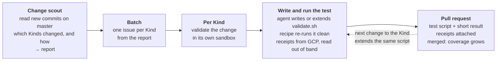

# Automated Validation of Controllers: Out-of-Band Checks and Growing Coverage

## 1. Overview

Automated validation checks every Config Connector controller that changes on master, the way a
careful person would check one by hand - run the controller, `kubectl apply` a resource and its
dependencies, then look at Google Cloud **with tools the controller does not use** (`gcloud`/`bq`,
raw REST, Cloud Audit Logs, and a functional check where one exists) after create, update and
delete - but without a person: an agent writes the check as a plain shell script,
`hack/manual-validate/<kind>/validate.sh`, a recipe runs it, and every check leaves a receipt.



It runs on its own for every Kind whose controller changed, so it does two things at once:

- **It validates each change out of band.** A new controller, a new or changed field, or a change in
  how a field is sent is checked against what Google Cloud actually holds - not against what the
  controller reports about itself.
- **It grows test coverage.** Each validation leaves a reviewed, reusable script behind, and later
  changes extend it instead of replacing it, so coverage accumulates Kind by Kind and field by field.

The scripts are ordinary files in the repository: anyone can read one, re-run it against their own
project, and extend it.

## 2. Problem

KCC's E2E fixtures (`pkg/test/resourcefixture/testdata/...`) record a controller's HTTP traffic
against real GCP once (`hack/record-gcp`), then replay it against MockGCP in CI, comparing golden
objects and logs. They are fast, deterministic and catch regressions well, but they share a blind
spot: **every observation goes through the controller.** The golden object is what the controller
wrote to `status`; the golden log is the requests the controller chose to make. A field the
controller silently drops, an update it applies by recreating the resource, or a value GCP stores
differently from the spec can all pass, because nothing looks at the resource from the outside.

At the same time the number of Kinds is growing quickly (around 50 new direct controllers in a week
of greenfield work), and reviewers have no cheap, independent evidence that each one behaves as its
spec says. Writing such evidence by hand for every Kind does not scale.

## 3. Goals

- Validate a controller's behaviour against Google Cloud using **independent** observations.
- Do it for **every Kind that changes**, automatically, focused on **what changed**.
- Leave behind **auditable** artifacts: a readable script, and receipts for every check.
- Make coverage **cumulative**: each change adds checks; none are lost.
- Keep the agent honest: its job is a **correct** test, not a passing one.

Non-goals: replacing E2E fixtures or MockGCP; testing webhook-only behaviour (see §9); load or
performance testing.

## 4. How it complements E2E tests

| | E2E fixtures (record + replay) | Automated validation |
|---|---|---|
| Question answered | Does the controller still make the same calls and produce the same object? | Does GCP hold what the spec says, after each step? |
| Source of truth | The controller's own HTTP log and `status` | Google Cloud, read by other clients |
| Runs against | MockGCP in CI (real GCP once, to record) | Real GCP, every run |
| Catches | Regressions in calls and objects | Dropped or mis-sent fields, recreate-instead-of-update, leaks, behaviour that only shows in use |
| Cost | Cheap, every PR | Real resources, minutes per Kind; per changed Kind, not per PR |
| Artifact | Golden files | A script per Kind, plus receipts per run |

The two reinforce each other: automated validation starts from the Kind's E2E fixture
(`-maximal`/`-full`), and a failure it finds becomes a controller bug with evidence attached.

## 5. Design

### 5.1 A validation run

`lib.sh` and `kcc-local` provide the environment: an envtest API server with all CRDs, the KCC
admission webhooks, the same controller manager as `cmd/manager`, and the deletion defender, all
local, using Application Default Credentials against a test project. A Kind's `validate.sh` then
runs these phases:

| Phase | Kubernetes action | Checked out of band |
|---|---|---|
| setup | enable the APIs it needs (`mv_enable_apis`), start local KCC | API state recorded |
| dependencies | apply, wait Ready | REST GET 200 for each |
| create | apply, wait Ready (generation observed) | every spec field compared with the value read from GCP; the service's CLI; a functional check |
| update | apply, wait Ready (generation advanced) | changed fields updated in GCP, others intact; functional check reflects it |
| steady | wait | still Ready, no further writes |
| delete | delete, wait gone | REST 404; Cloud Audit Logs show exactly one create, update and delete - updated in place, no idle writes |
| teardown | delete dependencies | REST 404 each; no panics in the manager log |

A trap always cleans up and leak-checks GCP over REST. Every check is recorded with `mv_record` to
`results.tsv`, with its evidence file (the raw REST response, the CLI output, the audit entries),
and summarised in `REPORT.md`.

### 5.2 Out-of-band rules

These are what make a PASS mean something:

- **Expected values come from the applied object; actual values come from GCP.** A check never
  compares KCC `status` with KCC `spec`.
- **Observations never go through the controller:** raw REST with a separately obtained token,
  `gcloud`/`bq`, audit logs, and functional checks (query through a row access policy, publish to a
  topic). No KCC clients, no MockGCP.
- **Audit logs prove what happened, not just the end state.** "Exactly Create, Update, Delete" shows
  an update was applied in place and nothing was written while idle - which end-state reads alone
  cannot.
- **PASS and FAIL are computed by the helpers** (`mv_expect_jq`, `mv_expect_eq`, `mv_expect_http`,
  `mv_expect_audit`), not stated by anyone.

### 5.3 Automation

```
change scout (git only)     batch (fan-out issue)        per Kind (validate-kind recipe)        review
changed_kinds.py        ->  one plain issue per Kind ->  agent writes/extends + runs script  ->  PR: short summary
open-batch.sh (chore)       label overseer/validate-kind recipe re-runs it from clean           + receipts.md attached
                            window 2-3                   receipts.md (bundle-receipts.sh)       (factory-copied)
```

- **Change scout** (`hack/manual-validate/changed_kinds.py`) reads only git. For each first-parent
  commit since the previous batch it maps files to Kinds and classes the change: *new* controller,
  *fields* (spec fields added, removed or changed), *behaviour* (controller, mapper, identity), or not
  worth a run (*types* with no direct controller, *mechanical* bulk refactors - sampled -, *tests*,
  *generated*).
- **Batch.** `open-batch.sh`, run on a schedule by the `.agents/verify-changes.md` chore, opens one
  fan-out issue (`validate-kind/batch`) per window of commits. Its task names what changed for each
  Kind and the rules for writing the script; the fan-out creates one child issue per Kind
  (`overseer/validate-kind`), two or three at a time.
- **Per Kind.** The `validate-kind` watch rule runs the `validate-kind` recipe on each child, built
  like `assess-controller` - judgement and evidence are separate steps:
  1. the agent reads the change, writes or extends the script, and **runs it itself until the script
     is valid** (5.4);
  2. the recipe re-runs the **committed** script from a clean start - the default fixture and every
     variant - and bundles that run's receipts into `receipts.md`;
  3. the agent writes a short PR description from those receipts;
  4. the factory attaches `receipts.md` to the PR verbatim, with its size and sha256
     (`task-output.comment.attach`).
- **Nothing to add.** If the script already covers the change, the agent commits nothing; the issue
  gets the same receipts as a comment and closes (`<!-- factory:no-change ok -->`). The batch closes
  when every child is closed.

### 5.4 A correct test, not a passing one

The agent is told what a **valid** script is: one clean run that goes through every phase, checks
every spec field the manifests set against GCP, has a receipt behind every PASS and every FAIL, and
leaks nothing. A valid script may report FAILs; a FAIL is the controller's when the script asked the
right question and GCP answered differently from the spec.

Between its runs the agent may fix only the script's own mistakes, each shown from the receipts (a
wrong URL, a jq path, a missing API, eventual consistency through bounded polls). It must not change
an expected value to what GCP returned, remove or loosen a check, retry until a mismatch reads
differently, or touch the controller, types or fixtures. It logs each script fix with the receipt
that justifies it, and stops when the script is valid - whatever it reports.

Three things back this up: the recipe's own clean re-run is the result (not the agent's runs); the
receipts are attached by the factory, not retyped; and review compares the script with master (5.6).

### 5.5 Auditability

- **Scripts are plain bash** on a small, documented helper library, readable in a few minutes.
- **Anyone can re-run one** (the harness lives under `hack/manual-validate/`, named for checking
  the way a person does by hand): `GCP_PROJECT_ID=<project> hack/manual-validate/<kind>/validate.sh`.
- **Every run leaves receipts** under `artifactz/manual-validation/<Kind>/<time>/` (gitignored):
  the exact manifests applied, object snapshots per phase, every REST and CLI response, audit
  entries, the manager log, and `REPORT.md`. The PR carries them, with project numbers and emails
  masked.
- **The PR states the result in a few lines** (what changed, PASS/FAIL per run, controller bugs,
  what could not be checked); the receipts below it are the evidence.

### 5.6 Expandability and cumulative coverage

- A Kind's checks grow with its changes: a new field is set in a manifest, compared with GCP after
  create, and changed in the update phase if it is mutable.
- Fields the test fixture does not set go in **variants**, `hack/manual-validate/<kind>/fixtures/<name>/`
  (`dependencies.yaml`, `create.yaml`, `update.yaml`). Every run covers the default fixture and every
  variant; the script takes its fixture from `FIXTURE_DIR` and records it, and the recipe flags any
  variant the script ignored.
- **Add, never replace:** an existing check or variant changes only when the API itself changed what
  it checks, and the PR says so. Review compares the script and its variants with master.

Over time each Kind's script becomes a field-by-field record of what was verified against Google
Cloud, and when.

### 5.7 Safety and cost

- Runs use the test project the overseer injects (`GCP_PROJECT_ID`); `mv_enable_apis` enables the
  APIs a Kind needs and never disables any (the project is shared).
- Every resource is named with a per-run id; cleanup always runs and leak-checks GCP.
- The fan-out window (2-3 Kinds at a time) bounds concurrent real resources and agent sessions; each
  Kind runs in its own sandbox.

## 6. Components

| Component | Where |
|---|---|
| Local KCC (envtest, webhooks, manager, deletion defender) | `hack/manual-validate/kcc-local/` |
| Helpers: bring-up, apply/wait, REST/CLI receipts, APIs, audit, report | `hack/manual-validate/lib.sh` |
| A Kind's script (reference: BigQueryRowAccessPolicy) | `hack/manual-validate/<kind>/validate.sh` |
| Fixture variants | `hack/manual-validate/<kind>/fixtures/<name>/` |
| How an agent writes and judges a script | `.gemini/skills/manual-validate-controller/SKILL.md` |
| Receipts bundle (one file per run set) | `hack/manual-validate/bundle-receipts.sh` |
| Change scout | `hack/manual-validate/changed_kinds.py` |
| Batch opener and its chore | `hack/manual-validate/open-batch.sh`, `.agents/verify-changes.md` |
| Per-Kind rule and recipe | `.agents/watch/validate-kind.yaml`, `.agents/recipes/validate-kind.yaml` |

## 7. Example

BigQueryRowAccessPolicy (the reference script): 35 checks, all PASS, in about 2.5 minutes. Create:
REST shows the filter predicate and policy id match the spec, `getIamPolicy` shows the grantee,
`bq ls` lists the policy, and a real query returns only the rows the policy allows. Update: the new
predicate is in GCP and the query returns the other rows. Delete: REST 404, the audit log shows
exactly create, update and delete, and the query sees every row again.

## 8. Alternatives considered

- **More E2E fixtures only.** Cheaper per run, but every observation still goes through the
  controller (§2).
- **An agent that validates without leaving a script.** Each run would be a one-off; nothing
  accumulates, nothing can be re-run or reviewed.
- **Agent-reported results.** Replaced by a recipe-run clean pass whose receipts the factory attaches.
- **Issue graphs per Kind.** Two issues per Kind (graph parent and step) for a one-step task; plain
  issues with a no-change marker do the same with one.

## 9. Limitations and future work

- **Admission-only behaviour:** the immutable-fields webhook cannot run under envtest, so immutability
  enforced only at admission is not covered.
- **Coverage measurement:** "every spec field" is an instruction today; a helper that lists the
  applied object's spec fields and the ones the script asserted would make gaps visible in the
  report.
- **Drift:** out-of-band changes followed by reconciliation are not yet a standard phase.
- **Periodic re-runs:** merged scripts could be re-run on a schedule without an agent, as a
  regression suite; an agent is needed only when one fails.
- **Receipt storage:** receipts beyond what fits in a PR stay in the sandbox; a durable store would
  keep every run's raw evidence.
