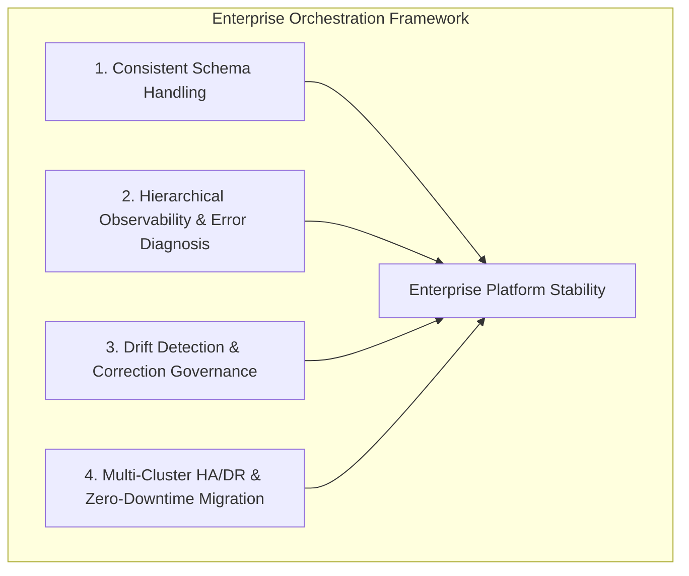
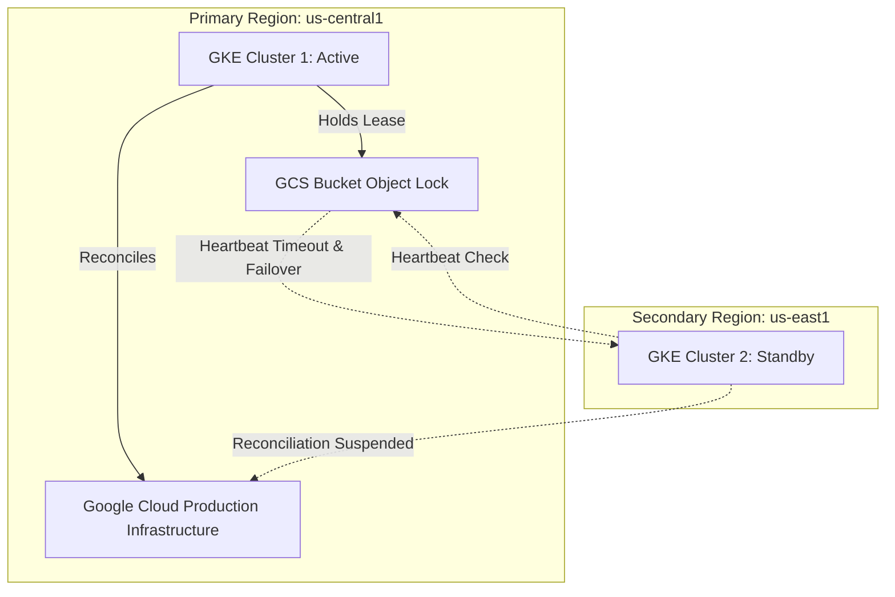

<!--
Copyright 2026 Google LLC

Licensed under the Apache License, Version 2.0 (the "License");
you may not use this file except in compliance with the License.
You may obtain a copy of the License at

     http://www.apache.org/licenses/LICENSE-2.0

Unless required by applicable law or agreed to in writing, software
distributed under the License is distributed on an "AS IS" BASIS,
WITHOUT WARRANTIES OR CONDITIONS OF ANY KIND, either express or implied.
See the License for the specific language governing permissions and
limitations under the License.
-->

# Enterprise Declarative Orchestration Guide

This guide establishes the architectural blueprint, operational standards, and runbooks for managing Google Cloud infrastructure at enterprise scale using Config Connector (KCC). It directly addresses critical declarative orchestration capability gaps encountered in production environments: consistent schema handling, error observability across complex resource hierarchies, drift detection and correction configurations, active-passive multi-cluster high availability (HA/DR), and non-destructive zero-downtime migration pathways.

---

## 1. Overview & Architectural Framework

Enterprise infrastructure platforms require declarative infrastructure-as-code (IaC) engines that can reliably arbitrate state between Kubernetes control planes and cloud service provider APIs across multi-tenant, multi-region environments.

Config Connector bridges Kubernetes Resource Model (KRM) declarations with Google Cloud Platform (GCP) APIs. However, large enterprise deployments must navigate four foundational capability domains:



1. **Consistent Schema Handling**: Ensuring uniform OpenAPI validation schemas across 270+ custom resource definitions (CRDs), mitigating Kubernetes 1.28+ status pruning, enforcing Server-Side Apply (SSA), and preventing admission webhook conflicts.
2. **Hierarchical Observability & Error Diagnosis**: Unambiguously propagating status conditions across nested dependency graphs (Organization &rarr; Folder &rarr; Project &rarr; Infrastructure &rarr; IAM) and isolating cloud provider errors from Kubernetes reconciliation states.
3. **Drift Detection & Correction Governance**: Configuring actuation modes, re-reconciliation intervals, management conflict prevention policies, deletion safety policies, and failover diff suppression.
4. **Multi-Cluster HA/DR & Zero-Downtime Migration**: Orchestrating active-passive multi-region failover via `MultiClusterLease` (MCL) and executing safe migrations from managed platforms (Config Controller, GKE Addon) to customer-managed Standalone KCC.

---

## 2. Pillar 1: Consistent Schema Handling

Enterprise GitOps engines (such as ArgoCD or Config Sync) manage thousands of declarative manifests. Minor schema inconsistencies or control-plane incompatibilities can disrupt synchronization loops or lead to silent data loss.

### 2.1 Mitigation of Status Pruning on Kubernetes 1.28+

Modern Kubernetes control planes (Kubernetes 1.28 and later) enforce strict structural schema validation on custom resources. Status subresource fields submitted to the Kubernetes API server are silently pruned on write unless:
1. The field is explicitly defined in the CRD's `spec.versions[].schema.openAPIV3Schema.properties.status` specification, OR
2. The schema block is explicitly marked with `x-kubernetes-preserve-unknown-fields: true`.

#### The Status Pruning Failure Mode
When deploying custom or experimental controllers (such as the `MultiClusterLease` leader election daemon), unmodeled status fields (e.g., `status.currentLeader`, `status.isLeader`, `status.lastHeartbeatTime`) are pruned by the API server. This causes reconciliation and leader election to fail with:
```text
failed to confirm leadership in status: context deadline exceeded
```

#### Remediation Pattern
Ensure all custom and extension CRDs define structural schemas or explicitly enable preservation of unknown fields:

```yaml
apiVersion: apiextensions.k8s.io/v1
kind: CustomResourceDefinition
metadata:
  name: multiclusterleases.multicluster.core.cnrm.cloud.google.com
spec:
  group: multicluster.core.cnrm.cloud.google.com
  names:
    kind: MultiClusterLease
    plural: multiclusterleases
    singular: multiclusterlease
  scope: Namespaced
  versions:
    - name: v1alpha1
      served: true
      storage: true
      subresources:
        status: {}
      schema:
        openAPIV3Schema:
          type: object
          x-kubernetes-preserve-unknown-fields: true
          properties:
            spec:
              type: object
              properties:
                leaseDurationSeconds:
                  type: integer
                renewDeadlineSeconds:
                  type: integer
                retryPeriodSeconds:
                  type: integer
            status:
              type: object
              x-kubernetes-preserve-unknown-fields: true
              properties:
                isLeader:
                  type: boolean
                currentLeader:
                  type: string
                lastHeartbeatTime:
                  type: string
                  format: date-time
```

### 2.2 Mandatory Server-Side Apply (SSA) for Complex Schemas

Standard client-side `kubectl apply` records the entire serialized manifest into the `kubectl.kubernetes.io/last-applied-configuration` metadata annotation. Kubernetes imposes a hard limit of 262,144 bytes (256 KB) on metadata annotations.

Because Config Connector CRD bundles and large declarative stacks (such as AI/ML scheduling CRDs like Kueue and JobSet) exceed this threshold, client-side apply fails with:
```text
metadata.annotations: Too long: may not be more than 262144 bytes
```

#### Enterprise Standard
All automated deployment pipelines, CI scripts, and GitOps tools **must** be configured to use Server-Side Apply (`--server-side=true`). Server-Side Apply calculates diffs directly in the Kubernetes API server using `managedFields`, completely eliminating the client-side annotation size limit:

```bash
# Applying CRD bundles or large resources via Server-Side Apply
kubectl apply --server-side --force-conflicts -f crds.yaml
```

In ArgoCD, configure this globally or per application:
```yaml
spec:
  syncPolicy:
    syncOptions:
      - ServerSideApply=true
```

### 2.3 Immutable Field Protection & GitOps 3-Way Merge

Config Connector utilizes an admission webhook (`deny-immutable-field-updates`) to block client requests that attempt to modify immutable GCP resource attributes (e.g., `spec.location`, `spec.projectRef`, or database engine versions).

During brownfield adoption or migration:
1. Config Connector sets `cnrm.cloud.google.com/state-into-spec: absent` to prevent copying server-defaulted attributes back into the Kubernetes `spec`.
2. The controller writes `spec.resourceID`.
3. If GitOps manifests omit `spec.resourceID` or attempt to mutate immutable fields during 3-way merge patching, the admission webhook rejects the update, stalling synchronization.

#### Enterprise Standard
Explicitly declare `spec.resourceID` in all GitOps source manifests, and set `cnrm.cloud.google.com/state-into-spec: absent` to prevent drift loops between Git declarations and API defaults.

---

## 3. Pillar 2: Hierarchical Observability & Error Diagnosis

Enterprise GCP environments are structured around multi-tier resource hierarchies:

```text
Organization (Root)
└── Folder (Line of Business)
    └── Project (Environment / Workload)
        ├── Network (Shared VPC / Subnets)
        ├── Security (KMS CryptoKeys / IAM Roles)
        └── Stateful Infrastructure (Cloud SQL, Spanner, GKE)
```

### 3.1 Resource References & Dependency DAGs

Config Connector provides three mechanisms for linking resources across the hierarchy:

1. **Local Namespace Reference**: Resolves resources managed within the same Kubernetes namespace:
   ```yaml
   networkRef:
     name: shared-vpc
   ```
2. **Cross-Namespace Reference**: Resolves resources managed in a separate Kubernetes namespace (e.g., central networking project):
   ```yaml
   networkRef:
     name: shared-vpc
     namespace: networking-prod
   ```
3. **External Reference**: Points directly to an existing Google Cloud resource using its canonical URI or identifier:
   ```yaml
   networkRef:
     external: projects/shared-vpc-host-prod/global/networks/shared-vpc
   ```

### 3.2 Diagnosing Hierarchical Status Conditions

Every Config Connector resource reports its reconciliation lifecycle via `status.conditions`. To reliably diagnose enterprise hierarchies, monitor the following condition reasons:

| Status Condition Reason | Meaning | Operational Action Required |
| :--- | :--- | :--- |
| `UpToDate` | Desired state matches live GCP state (`Ready: True`). | No action. Resource is operational. |
| `DependencyNotReady` | Referenced parent or dependency resource (e.g., `projectRef` or `cryptoKeyRef`) exists but is not yet in `Ready: True` state. | Inspect the status conditions of the referenced upstream resource in the DAG. |
| `DependencyNotFound` | Referenced resource cannot be found in the Kubernetes namespace or external GCP URI is invalid. | Verify spelling, namespace scoping, or external resource presence. |
| `ManagementConflict` | Another KCC instance or external system owns the GCP resource lease lock. | Check `cnrm.cloud.google.com/management-conflict-prevention-policy` or resolve split-brain controllers. |
| `UpdateFailed` / `CreateFailed` | GCP API rejected the call (`Ready: False`). | Inspect `status.conditions[].message` for GCP HTTP status codes (e.g., `403 PermissionDenied`, `400 InvalidArgument`). |
| `FailoverInProgress` | Autonomous cloud operation (e.g., Cloud SQL failover/switchover) in flight; controller in non-blocking standby. | Wait for operation completion; do not attempt mutating updates. |

#### Structured Diagnosis Script
Use `kubectl` to quickly isolate failed dependencies in a multi-tenant hierarchy:

```bash
# List all unready resources across all namespaces with reasons and error messages
kubectl get gcp -A -o jsonpath='{range .items[?(@.status.conditions[0].status!="True")]}{.kind}/{{.metadata.namespace}}/{{.metadata.name}}{"\t"}{.status.conditions[0].reason}{"\t"}{.status.conditions[0].message}{"\n"}{end}'
```

---

## 4. Pillar 3: Drift Detection & Correction Governance

Continuous reconciliation guarantees that live infrastructure matches declared configuration. However, enterprise platform teams must govern how aggressively drift is corrected to balance safety, quota consumption, and operational drills.

### 4.1 Re-Reconciliation Interval Tuning

By default, Config Connector re-reconciles resources periodically (typically every 10 to 15 minutes) to detect out-of-band changes. In large fleets with tens of thousands of resources, aggressive re-reconciliation can exhaust GCP API quotas.

Configure the re-reconciliation frequency per resource using the `cnrm.cloud.google.com/reconcile-interval` annotation:

```yaml
apiVersion: storage.cnrm.cloud.google.com/v1beta1
kind: StorageBucket
metadata:
  name: cold-archive-bucket
  annotations:
    cnrm.cloud.google.com/reconcile-interval: "1h" # Poll once per hour
spec:
  location: US
```

### 4.2 Actuation Modes: Pausing Reconciliation

During emergency incident response or manual GCP maintenance, platform teams can suspend Config Connector's active reconciliation without deleting or altering Kubernetes resources:

#### Global or Namespace-Level Pause
Set `actuation: Paused` on the `ConfigConnector` or `ConfigConnectorContext` resource:
```yaml
apiVersion: core.cnrm.cloud.google.com/v1beta1
kind: ConfigConnectorContext
metadata:
  name: configconnectorcontext.core.cnrm.cloud.google.com
  namespace: payment-workloads
spec:
  actuation: Paused # KCC stops issuing API calls to GCP for this namespace
  googleServiceAccount: "kcc-sa@my-prod-project.iam.gserviceaccount.com"
```

#### Per-Resource Pause
Annotate a specific resource to freeze its reconciliation loop:
```yaml
metadata:
  annotations:
    cnrm.cloud.google.com/reconcile-interval: "0" # Setting interval to 0 disables polling
```

### 4.3 Management Conflict Prevention Policy

Config Connector protects against split-brain reconciliation (two controllers fighting over the same cloud asset) by writing ownership labels to GCP resources:
* `cnrm-lease-holder-id`: Unique identifier of the managing controller instance.
* `cnrm-lease-expiration`: Timestamp after which the lease expires.

#### Conflict Prevention Configurations
* **`resource` (Default)**: Strict locking. If another controller's lock is detected, reconciliation fails with `ManagementConflict`.
* **`none`**: Disables lease label verification. **Required** when performing cross-cluster migrations, deploying multi-cluster standby replicas, or transitioning between controller modes.

```yaml
metadata:
  annotations:
    cnrm.cloud.google.com/management-conflict-prevention-policy: "none"
```

### 4.4 Deletion Policy: Accidental Destruction Protection

By default, deleting a Kubernetes resource triggers an HTTP `DELETE` to the underlying GCP API. For mission-critical databases, VPCs, KMS keys, and IAM bindings, platform teams must prevent cascading deletions during cluster rebuilds or GitOps pipeline resets:

```yaml
metadata:
  annotations:
    cnrm.cloud.google.com/deletion-policy: "abandon"
```
When set to `abandon`, deleting the Kubernetes resource cleanly removes Kubernetes finalizers, leaving 100% of the live Google Cloud infrastructure online and untouched.

### 4.5 Autonomous Diff Suppression (Failover & Switchovers)

Stateful cloud infrastructure often executes autonomous role inversions. For instance, in Cloud SQL Enterprise Disaster Recovery (DR), a cross-region switchover promotes the read replica to `PRIMARY` and demotes the original primary to a replica.

In traditional controllers, this creates an infinite drift loop where GitOps repeatedly attempts to revert `.masterInstanceName`. Config Connector Direct Controllers incorporate native **diff suppression** to recognize active failover operations, update runtime status (`status.currentRole`), and suppress spurious diffs on inverted fields without fighting Git declarations.

---

## 5. Pillar 4: Multi-Cluster High Availability & Disaster Recovery (MCL)

For Tier-0 enterprise platforms, relying on a single Kubernetes cluster introduces a single point of failure. Running Config Connector across an active-passive multi-cluster topology provides automated disaster recovery across geographical regions.



### 5.1 Architecture & Leadership Arbitration

1. **Distributed GCS Generation Lock**: Both clusters run the `MultiClusterLease` (MCL) daemon, referencing a shared Cloud Storage bucket object. Leadership arbitration uses atomic object generation match preconditions (`IfGenerationMatch`).
2. **Active Leader**: The active cluster acquires the lease, starts the `cnrm-controller-manager` reconcilers, and continuously heartbeats to GCS.
3. **Passive Standby**: The standby cluster observes the active lease and suspends reconciliation. KRM manifests remain mirrored in etcd (via GitOps), ready for immediate activation.
4. **Automated Failover (RTO < 30s)**: If the primary region fails, lease renewal expires. The standby cluster atomically claims the lease object, updates `status.isLeader: true`, and starts reconciliation with zero lock collisions and zero split-brain execution.

### 5.2 Enabling MultiClusterLease in ConfigConnector

Configure `spec.experiments.multiClusterLease` in the `ConfigConnector` custom resource:

```yaml
apiVersion: core.cnrm.cloud.google.com/v1beta1
kind: ConfigConnector
metadata:
  name: configconnector.core.cnrm.cloud.google.com
spec:
  mode: cluster
  googleServiceAccount: "kcc-ha-system@prod-mgmt-project.iam.gserviceaccount.com"
  experiments:
    multiClusterLease:
      leaseName: "kcc-global-lease"
      namespace: "configconnector-operator-system"
      clusterCandidateIdentity: "gke-us-central1-prod" # Unique cluster identifier
```

---

## 6. Pillar 5: Zero-Downtime Migration Runbook (Config Controller to Standalone KCC)

Organizations transitioning from Google-Managed Config Controller (ACP) or the GKE Addon to Customer-Managed Standalone KCC must execute cross-cluster cutovers without taking workload downtime or triggering destructive cloud API calls.

### 6.1 The Five Mandatory Migration Invariants

Any zero-downtime migration must guarantee five safety invariants:

1. **Deletion Policy Invariant (`abandon`)**: Prevents source cluster teardown from cascading into live GCP deletions.
2. **Conflict Prevention Invariant (`none`)**: Prevents target cluster reconcilers from blocking on stale source cluster lock labels.
3. **GitOps 3-Way Merge Invariant (`state-into-spec: absent`)**: Prevents admission webhooks from rejecting synchronization due to unmanaged status/spec fields.
4. **Teardown Sequence Invariant (Operator-Aware)**: Guarantees tenant workload finalizers resolve *before* tenant `ConfigConnectorContext` or operator pods are terminated.
5. **Project Scoping Invariant**: Ensures explicit `cnrm.cloud.google.com/project-id` annotations are stamped on all tenant namespaces.

### 6.2 Tooling Comparison: Automated CLI vs. Native Scripting

| Capability | Automated CLI (`kcc-migrate`) | Native Scripting (Zero-Binary Runbook) |
| :--- | :--- | :--- |
| **Execution Environment** | Go binary run from administrator workstation/bastion. | Native `kubectl`, `yq`, and `gcloud` available in all air-gapped jumpboxes. |
| **Discovery Throughput** | Concurrent 20-worker pool (~12 seconds across 270+ CRDs). | Sequential or backgrounded shell loop (~3-4 minutes per namespace). |
| **AST Transformation** | Native Go AST YAML parser. | Streamlined `yq` (version 4.x) expressions. |
| **Rollback Capability** | Automated single-command rollback (`kcc-migrate rollback`). | Manual inverse script execution. |
| **Compliance Posture** | Requires binary installation approval. | 100% compliant with strict zero-binary jumpbox security policies. |

---

### 6.3 Copy-Pasteable Zero-Binary Migration Runbook

This step-by-step procedure uses standard `kubectl` and `yq` to execute an air-gapped, zero-downtime migration from a source Config Controller cluster (`CTX_SOURCE`) to a target Standalone KCC cluster (`CTX_TARGET`).

#### Environment Setup
```bash
export CTX_SOURCE="gke_source_config_controller"
export CTX_TARGET="gke_target_standalone_kcc"
export TARGET_NAMESPACES="tenant-app-prod,tenant-data-prod"
export WORKDIR="/tmp/kcc-migration"
mkdir -p "${WORKDIR}/raw" "${WORKDIR}/sanitized"
```

#### Phase 1: Freeze Source GitOps
Suspend synchronization on the source cluster to prevent reconciling mid-flight changes:
```bash
# If using Config Sync:
kubectl --context="${CTX_SOURCE}" scale deployment root-reconciler -n config-management-system --replicas=0

# If using ArgoCD:
kubectl --context="${CTX_SOURCE}" patch application kcc-workloads -n argocd --type=merge -p '{"spec":{"syncPolicy":null}}'
```

#### Phase 2: Parallel Discovery & Manifest Export
Discover all registered Config Connector CRDs and extract live resources:
```bash
echo "Discovering active KCC CRDs..."
CRDS=$(kubectl --context="${CTX_SOURCE}" api-resources --verbs=list -o name | grep '\.cnrm\.cloud\.google\.com$' | sort -u)

for NS in $(echo "${TARGET_NAMESPACES}" | tr ',' ' '); do
  echo "Exporting live resources for namespace: ${NS}..."
  mkdir -p "${WORKDIR}/raw/${NS}"
  for CRD in ${CRDS}; do
    kubectl --context="${CTX_SOURCE}" get "${CRD}" -n "${NS}" -o yaml > "${WORKDIR}/raw/${NS}/${CRD}.yaml" 2>/dev/null || true
    # Remove empty list outputs
    if grep -q "items: \[\]" "${WORKDIR}/raw/${NS}/${CRD}.yaml"; then
      rm -f "${WORKDIR}/raw/${NS}/${CRD}.yaml"
    fi
  done
done
```

#### Phase 3: Manifest Sanitization & Invariant Stamping
Strip runtime metadata and inject required safety invariants using `yq`:
```bash
for NS in $(echo "${TARGET_NAMESPACES}" | tr ',' ' '); do
  echo "Sanitizing manifests for namespace: ${NS}..."
  mkdir -p "${WORKDIR}/sanitized/${NS}"

  for FILE in "${WORKDIR}/raw/${NS}"/*.yaml; do
    [ -f "${FILE}" ] || continue
    BASENAME=$(basename "${FILE}")

    # Use yq to:
    # 1. Unpack items list
    # 2. Strip runtime metadata (uid, resourceVersion, generation, managedFields, status)
    # 3. Strip source finalizers
    # 4. Inject deletion-policy: abandon
    # 5. Inject management-conflict-prevention-policy: none
    # 6. Inject state-into-spec: absent
    yq eval '
      .items[] |
      del(.metadata.uid) |
      del(.metadata.resourceVersion) |
      del(.metadata.generation) |
      del(.metadata.managedFields) |
      del(.metadata.creationTimestamp) |
      del(.metadata.finalizers) |
      del(.status) |
      .metadata.annotations["cnrm.cloud.google.com/deletion-policy"] = "abandon" |
      .metadata.annotations["cnrm.cloud.google.com/management-conflict-prevention-policy"] = "none" |
      .metadata.annotations["cnrm.cloud.google.com/state-into-spec"] = "absent"
    ' "${FILE}" > "${WORKDIR}/sanitized/${NS}/${BASENAME}"

    # Remove file if no documents remained
    if [ ! -s "${WORKDIR}/sanitized/${NS}/${BASENAME}" ]; then
      rm -f "${WORKDIR}/sanitized/${NS}/${BASENAME}"
    fi
  done
done
```

#### Phase 4: Safety Linting & Server-Side Dry Run
Perform server-side validation against the target cluster API server:
```bash
echo "Executing Server-Side Dry Run against target cluster..."
for NS in $(echo "${TARGET_NAMESPACES}" | tr ',' ' '); do
  # Ensure namespace exists on target
  kubectl --context="${CTX_TARGET}" create namespace "${NS}" --dry-run=client -o yaml | kubectl --context="${CTX_TARGET}" apply -f -

  for FILE in "${WORKDIR}/sanitized/${NS}"/*.yaml; do
    [ -f "${FILE}" ] || continue
    kubectl --context="${CTX_TARGET}" apply --server-side --dry-run=server -f "${FILE}"
  done
done
echo "Dry run successful. All manifests conform to target schemas."
```

#### Phase 5: Phased Adoption into Target Standalone KCC
Apply sanitized resources in topological order (Foundations &rarr; Security/Networking &rarr; Stateful Engines &rarr; IAM):
```bash
for NS in $(echo "${TARGET_NAMESPACES}" | tr ',' ' '); do
  echo "Adopting resources into target cluster for namespace: ${NS}..."
  for FILE in "${WORKDIR}/sanitized/${NS}"/*.yaml; do
    [ -f "${FILE}" ] || continue
    kubectl --context="${CTX_TARGET}" apply --server-side --force-conflicts -f "${FILE}"
  done

  echo "Awaiting Ready: True status on adopted resources in ${NS}..."
  kubectl --context="${CTX_TARGET}" wait --for=condition=Ready gcp -n "${NS}" --timeout=10m
done
```

#### Phase 6: GitOps Handover
1. Commit the sanitized declarations into your central GitOps repository.
2. Update the GitOps pipeline destination to point to `${CTX_TARGET}`.
3. Unfreeze sync loops.

#### Phase 7: Non-Destructive Source Cluster Detachment
Safely detach source resources by clearing finalizers and removing CRs without deleting backend GCP infrastructure:
```bash
echo "Safely removing finalizers from source cluster..."
for NS in $(echo "${TARGET_NAMESPACES}" | tr ',' ' '); do
  for CRD in ${CRDS}; do
    # Filter out ConfigConnectorContext and Operator CRDs to avoid premature pod termination
    if [[ "${CRD}" == *"configconnector"* ]]; then
      continue
    fi

    # Patch out finalizers from all resources of this CRD in the source namespace
    for RES in $(kubectl --context="${CTX_SOURCE}" get "${CRD}" -n "${NS}" -o jsonpath='{.items[*].metadata.name}' 2>/dev/null); do
      kubectl --context="${CTX_SOURCE}" patch "${CRD}" "${RES}" -n "${NS}" --type=merge -p '{"metadata":{"finalizers":[]}}' 2>/dev/null || true
      kubectl --context="${CTX_SOURCE}" delete "${CRD}" "${RES}" -n "${NS}" --wait=false 2>/dev/null || true
    done
  done
done
echo "Source cluster detachment complete. 100% of GCP resources remain online and active under Standalone KCC."
```

---

## 7. Enterprise Checklist for Platform Engineers

Before deploying Config Connector into production or initiating cross-cluster migrations, verify compliance with the following operational checklist:

- [ ] **Server-Side Apply**: GitOps tools and CI runners configured with `ServerSideApply=true` to prevent 256 KB annotation limits on CRDs.
- [ ] **Structural Schema Verification**: Custom and extension CRDs verified against Kubernetes 1.28+ status pruning rules.
- [ ] **Deletion Safety**: Mission-critical databases, storage buckets, networks, and KMS keys configured with `cnrm.cloud.google.com/deletion-policy: abandon`.
- [ ] **Quota & Interval Governance**: Re-reconciliation intervals tuned via `cnrm.cloud.google.com/reconcile-interval` to prevent API rate limiting.
- [ ] **Observability Dashboards**: Monitoring alerts established for `status.conditions[].status == "False"` filtering on `DependencyNotReady` and `ManagementConflict`.
- [ ] **Multi-Cluster HA/DR**: For multi-region architectures, `MultiClusterLease` verified with GCS bucket locks and heartbeat monitoring.
- [ ] **Zero-Downtime Migration Drills**: Migration runbooks and `kcc-migrate` procedures validated against staging environments before production cutovers.
